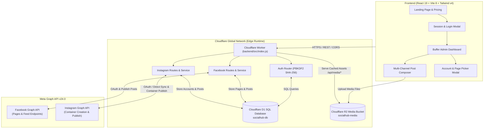
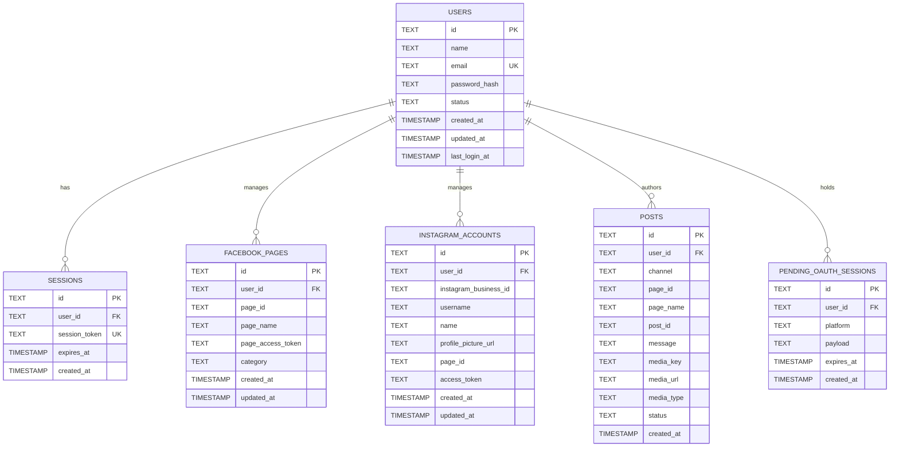

# 🚀 SocialHub AI — Next-Generation Social Media Management Platform

<div align="center">

[](https://react.dev/)
[](https://www.typescriptlang.org/)
[](https://vitejs.dev/)
[](https://tailwindcss.com/)
[](https://workers.cloudflare.com/)
[](https://developers.cloudflare.com/d1/)
[](https://developers.cloudflare.com/r2/)
[](https://developers.facebook.com/)

**An enterprise-grade, edge-first social media orchestration platform.**  
Connect, schedule, publish, and monitor content across Facebook Pages and Instagram Business accounts with high-performance Cloudflare Edge architecture and a Buffer-inspired dashboard interface.

[Explore Architecture](#-system-architecture) • [Key Features](#-core-features--capabilities) • [API Reference](#-api-documentation) • [Quickstart Guide](#-getting-started) • [Deployment](#-deployment--production)

</div>

---

## 📖 Overview

**SocialHub AI** is an advanced Social Media Management System (Final Year Project) designed to streamline multi-platform digital marketing. Built upon a modern decoupled monorepo architecture, SocialHub AI combines a ultra-responsive **React 19 + Tailwind CSS v4** single-page application with a serverless edge backend powered by **Cloudflare Workers**, **Cloudflare D1** (Serverless SQLite), and **Cloudflare R2** (S3-compatible Object Storage).

The platform provides end-to-end management for content creators, agencies, and businesses: from Meta Graph OAuth v24.0 authentication, multi-page selection, media processing, and containerized Instagram publishing, to a Buffer-style admin experience featuring streak trackers, unified post composer, and live post history.

---

## 🏛 System Architecture

The following diagram illustrates how clients communicate with Cloudflare edge services and Meta Graph APIs:



---

## ✨ Core Features & Capabilities

### 1. 🌐 Multi-Channel Meta Integrations (Graph API v24.0)
- **Facebook Pages Management**:
  - Secure OAuth 2.0 authorization code flow with CSRF state verification.
  - Automatic exchange for long-lived Page Access Tokens.
  - Multi-page picker: connect and toggle between multiple Facebook Pages.
  - Publishing for both text-only posts and photo posts (direct multipart/form-data or public URL).
- **Instagram Business Management**:
  - Direct Meta OAuth integration and Direct Access Token synchronization.
  - Multi-step media publishing workflow:
    1. Creates Instagram Media Containers via `/media`.
    2. Polls container status until `FINISHED` (handling `IN_PROGRESS`, `ERROR`, and `EXPIRED` states).
    3. Triggers final publication via `/media_publish`.
  - Profile data syncing: Instagram Business ID, handles, and avatars.

### 2. 🎛 Buffer-Inspired Admin Dashboard
- **Live Metric Dashboards**:
  - Real-time weekly streak tracker.
  - Daily posting goals monitor.
  - Comment engagement indicator.
  - Progress bar showing active connected channels count (e.g., `2/3 connected`).
- **Interactive First Steps Onboarding**:
  - Step 1: Connect channels with status badges.
  - Step 2: Create post trigger.
  - Step 3: Direct API & health verification link.
- **Universal Post Composer**:
  - Single interface to cross-post to Facebook and Instagram simultaneously.
  - Live image preview with drag-and-drop or file upload.
  - Direct image URL pasting with instant validation.
  - Multi-page/account dropdown selection.
  - Real-time publishing feedback with Facebook & Instagram Post IDs.
- **Content Feeds & History**:
  - Chronological log of published posts stored in Cloudflare D1.
  - Channel badge identification (Facebook blue, Instagram gradient/pink).

### 3. 🛡 Robust Security & Custom Authentication
- **Zero-Dependency Web Crypto Auth**:
  - Enterprise-grade PBKDF2 key derivation using SHA-256 with 100,000 iterations and 16-byte cryptographically secure random salts.
  - Strict password verification compatible with edge workers.
- **Session-Based Cookie Management**:
  - Secure, `HttpOnly`, `SameSite=Lax` cookie sessions (`session_token`) with 7-day TTL.
  - Active session validation via `/api/auth/me`.
  - Safe logout with cookie invalidation.
- **Strict CORS & Preflight Handling**:
  - Dynamically mirrors authorized origins (localhost, staging, production).
  - Explicit support for credentials (`credentials: 'include'`).

### 4. ⚡ Edge-Native Storage Architecture
- **Cloudflare D1 (Serverless SQL)**:
  - Relational schema storing users, sessions, Facebook pages, Instagram accounts, and post logs.
  - Native foreign key constraints with `ON DELETE CASCADE`.
- **Cloudflare R2 (Object Storage)**:
  - S3-compatible, zero-egress-fee bucket (`socialhub-media`).
  - Edge media proxy at `/api/media/:key` with HTTP `ETag` and `immutable` caching headers (`Cache-Control: public, max-age=31536000`).

### 5. 🤖 AI Agent & MCP Integration Ready
- Built to interface with Model Context Protocol (MCP) and conversational AI assistants (Claude, ChatGPT).
- Support for natural language queries to pull engagement data, draft post captions, and queue social updates.

---

## 🛠 Tech Stack

### Frontend Application
| Category | Technology | Description |
| :--- | :--- | :--- |
| **Framework** | [React 19](https://react.dev/) | Latest React concurrent features and modern state primitives |
| **Language** | [TypeScript 5.7](https://www.typescriptlang.org/) | Strict type checking and interface contracts |
| **Build Tool** | [Vite 8](https://vitejs.dev/) | Lightning-fast HMR and optimized ESM bundling |
| **Styling** | [Tailwind CSS v4](https://tailwindcss.com/) | Next-generation utility-first CSS via `@tailwindcss/vite` |
| **Icons** | [Lucide React](https://lucide.dev/) & [React Icons](https://react-icons.github.io/react-icons/) | Modern, clean vector iconography |
| **Charts** | [Recharts 3.10](https://recharts.org/) | Composable SVG data visualizations |
| **Utilities** | `clsx`, `tailwind-merge` | Conditional class name composition |

### Backend Edge API
| Category | Technology | Description |
| :--- | :--- | :--- |
| **Runtime** | [Cloudflare Workers](https://workers.cloudflare.com/) | Serverless V8 isolate runtime across 300+ edge locations |
| **Database** | [Cloudflare D1](https://developers.cloudflare.com/d1/) | Serverless SQLite database with global read replicas |
| **Object Storage**| [Cloudflare R2](https://developers.cloudflare.com/r2/) | S3-compatible object storage with zero egress fees |
| **Crypto** | Web Crypto API | PBKDF2 SHA-256 password hashing & cryptographic UUIDs |
| **Tooling** | [Wrangler 4.147](https://developers.cloudflare.com/workers/wrangler/) | Cloudflare developer CLI & local runtime emulator |
| **Testing** | [Vitest](https://vitest.dev/) | Edge-compatible test runner with `@cloudflare/vitest-plugin` |

---

## 🗄 Database Schema (Cloudflare D1)

The database schema is defined in [backend/schema.sql](file:///e:/Final%20SH/backend/schema.sql).



---

## 🔌 API Documentation

Base Local URL: `http://localhost:8787`

### 1. Authentication Endpoints
| Method | Endpoint | Description | Auth Required |
| :--- | :--- | :--- | :--- |
| `POST` | `/api/auth/register` | Register new user account with hashed password | No |
| `POST` | `/api/auth/login` | Authenticate with email & password, sets session cookie | No |
| `POST` | `/api/auth/logout` | Invalidate active session and clear cookie | Yes |
| `GET` | `/api/auth/me` | Fetch active authenticated user profile | Yes |

### 2. Facebook Management Endpoints
| Method | Endpoint | Description | Auth Required |
| :--- | :--- | :--- | :--- |
| `GET` | `/api/facebook/auth` | Starts Facebook OAuth authorization code flow | Yes |
| `GET` | `/api/facebook/callback`| Callback URL handling OAuth redirect from Facebook | No |
| `GET` | `/api/facebook/pages` | List all connected Facebook Pages for the active user | Yes |
| `POST` | `/api/facebook/pages/select` | Select and bind a Facebook page from pending OAuth session | Yes |
| `POST` | `/api/facebook/pages/activate` | Set active default Facebook Page for publishing | Yes |
| `POST` | `/api/facebook/post` | Publish text or photo post to selected Facebook Page | Yes |

### 3. Instagram Business Endpoints
| Method | Endpoint | Description | Auth Required |
| :--- | :--- | :--- | :--- |
| `GET` | `/api/instagram/auth` | Starts Instagram / Meta OAuth authorization flow | Yes |
| `GET` | `/api/instagram/callback` | Callback URL handling OAuth redirect from Meta | No |
| `GET` | `/api/instagram/accounts` | List connected Instagram Business accounts | Yes |
| `POST` | `/api/instagram/sync-token` | Direct sync with Instagram Access Token & Account ID | Yes |
| `POST` | `/api/instagram/accounts/select` | Select and bind account from pending OAuth session | Yes |
| `POST` | `/api/instagram/accounts/activate` | Set active default Instagram Business account | Yes |
| `POST` | `/api/instagram/post` | Multi-step photo post container creation and publish | Yes |

### 4. Posts & Media Endpoints
| Method | Endpoint | Description | Auth Required |
| :--- | :--- | :--- | :--- |
| `GET` | `/api/posts` | Retrieve user's historical post publishing log | Yes |
| `GET` | `/api/media/:key` | Public edge proxy streaming uploaded media from R2 bucket | No |
| `GET` | `/api/health` | Service health check returning runtime status | No |

---

## 📂 Project Directory Structure

```text
SocialHub-AI-FYP/
├── README.md                      # Comprehensive project documentation
├── .gitignore                     # Root git exclusion rules
│
├── backend/                       # Cloudflare Workers Serverless API
│   ├── wrangler.jsonc             # Cloudflare Worker configuration, D1 & R2 bindings
│   ├── package.json               # Backend dependencies & scripts
│   ├── schema.sql                 # D1 Database relational SQL schema
│   ├── .dev.vars.example          # Template for environment credentials
│   ├── src/
│   │   ├── index.js               # Edge worker entrypoint & request dispatcher
│   │   ├── routes/
│   │   │   ├── auth.js            # User registration, login, session handlers
│   │   │   ├── facebook.js        # Facebook OAuth, page selection, post handlers
│   │   │   └── instagram.js       # Instagram OAuth, token sync, post handlers
│   │   ├── services/
│   │   │   ├── facebook.js        # Graph API requests for Facebook Pages & posts
│   │   │   └── instagram.js       # Container creation, status polling & publishing
│   │   └── utils/
│   │       ├── auth.js            # PBKDF2 SHA-256 Web Crypto hashing & cookie logic
│   │       └── cors.js            # Dynamic CORS and preflight handling
│   └── test/                      # Vitest suite for backend services
│
└── front end/                     # React 19 + Vite 8 Single Page Application
    ├── package.json               # Frontend dependencies & scripts
    ├── vite.config.ts             # Vite configuration with Tailwind CSS plugin
    ├── tsconfig.json              # TypeScript compilation rules
    ├── index.html                 # HTML application shell
    └── src/
        ├── main.tsx               # React application entrypoint
        ├── App.tsx                # Master routing, view switching & state container
        ├── index.css              # Global styles, Tailwind CSS v4 directives
        ├── lib/
        │   ├── facebook.ts        # Facebook helper utilities
        │   ├── instagram.ts       # Instagram helper utilities
        │   └── utils.ts           # Classnames merging (clsx + twMerge)
        └── components/
            ├── Nav.tsx            # Sticky global header navigation
            ├── Hero.tsx           # Product hero section
            ├── TrustedBy.tsx      # Social proof & client logos
            ├── Channels.tsx       # Channel carousel & selection grid
            ├── CoreFeatures.tsx   # Interactive tabs: Publish, Create, Community, Insights
            ├── MoreFeatures.tsx   # Feature grid (collaboration, queue, link-in-bio)
            ├── AISection.tsx      # Buffer MCP & conversational AI preview
            ├── Support.tsx        # Customer service & community section
            ├── Metrics.tsx        # SocialHub impact metrics
            ├── CTA.tsx            # Conversion call-to-action banner
            ├── Footer.tsx         # Comprehensive multi-column footer
            ├── auth/
            │   └── LoginPage.tsx  # Dual Login / Registration Buffer-styled form
            ├── admin/
            │   ├── BufferDashboard.tsx       # Full Buffer admin portal & post composer
            │   ├── AccountPickerModal.tsx    # Modal to choose pages/accounts post-OAuth
            │   └── ConnectNewChannelModal.tsx# Multi-network connection directory
            └── pricing/
                └── PricingPage.tsx           # Complete pricing tiers & comparison
```

---

## 🚀 Getting Started

### Prerequisites
- **Node.js**: v18.0.0 or later (Node 20+ recommended)
- **npm** or **pnpm**
- **Cloudflare Wrangler CLI**: Installed locally or run via `npx wrangler`
- **Meta Developer Account**: Access to [Meta for Developers](https://developers.facebook.com/) for Facebook & Instagram Graph API credentials

---

### Step 1: Clone Repository
```bash
git clone https://github.com/HilalHussain-dev/SocialHub-AI-FYP.git
cd SocialHub-AI-FYP
```

---

### Step 2: Backend Setup (Cloudflare Worker)

1. Navigate to the backend directory and install dependencies:
   ```bash
   cd backend
   npm install
   ```

2. Create your local environment configuration:
   ```bash
   cp .dev.vars.example .dev.vars
   ```

3. Populate `.dev.vars` with your Meta credentials:
   ```env
   # Meta / Facebook App Credentials
   FACEBOOK_APP_ID="your_meta_app_id"
   FACEBOOK_APP_SECRET="your_meta_app_secret"
   FACEBOOK_REDIRECT_URI="http://localhost:8787/api/facebook/callback"

   # Instagram App Credentials (can match Facebook App)
   INSTAGRAM_APP_ID="your_meta_app_id"
   INSTAGRAM_APP_SECRET="your_meta_app_secret"
   INSTAGRAM_REDIRECT_URI="http://localhost:8787/api/instagram/callback"

   # Direct Token (Optional fallback)
   INSTAGRAM_ACCESS_TOKEN=""
   INSTAGRAM_BUSINESS_ACCOUNT_ID=""

   # Public Base URL (optional tunnel URL like ngrok for Instagram local photo posting)
   PUBLIC_BASE_URL=""
   ```

4. Initialize the Cloudflare D1 Local Database with the schema:
   ```bash
   npx wrangler d1 execute socialhub-db --local --file=./schema.sql
   ```

5. Start the backend development worker:
   ```bash
   npm run dev
   ```
   > Worker will start locally on `http://localhost:8787`. You can inspect endpoints and D1 storage using the printed local explorer URL.

---

### Step 3: Frontend Setup (React + Vite)

1. Open a new terminal and navigate to the frontend directory:
   ```bash
   cd "front end"
   npm install
   ```

2. (Optional) Create a `.env` file if you wish to override the backend API URL:
   ```env
   VITE_API_URL=http://localhost:8787
   ```

3. Start the Vite development server:
   ```bash
   npm run dev
   ```
   > Frontend will be accessible at `http://localhost:8443` (or `http://localhost:5173`).

---

## ⚙️ Meta Developer App Configuration

To enable Facebook Pages and Instagram Business posting:

1. Visit [Meta App Dashboard](https://developers.facebook.com/apps).
2. Create or select a **Business** type application.
3. Under **Add Products to Your App**, add:
   - **Facebook Login for Business**
   - **Instagram Graph API**
4. In **Facebook Login Settings**:
   - Add Valid OAuth Redirect URIs:
     - `http://localhost:8787/api/facebook/callback`
     - `http://localhost:8787/api/instagram/callback`
     - `https://<your-worker-domain>.workers.dev/api/facebook/callback`
     - `https://<your-worker-domain>.workers.dev/api/instagram/callback`
5. Permissions required in development/production:
   - `pages_show_list`
   - `pages_read_engagement`
   - `pages_manage_posts`
   - `public_profile`
   - `instagram_basic`
   - `instagram_content_publish`

---

## 🚢 Deployment & Production

### 1. Deploying the Backend to Cloudflare Workers
1. Authenticate with your Cloudflare account:
   ```bash
   npx wrangler login
   ```
2. Create the production D1 database and R2 bucket (if not already created):
   ```bash
   npx wrangler d1 create socialhub-db
   npx wrangler r2 bucket create socialhub-media
   ```
3. Update `backend/wrangler.jsonc` with your production `database_id`.
4. Apply the database schema to production D1:
   ```bash
   npx wrangler d1 execute socialhub-db --remote --file=./schema.sql
   ```
5. Set production secrets in Cloudflare Workers:
   ```bash
   npx wrangler secret put FACEBOOK_APP_ID
   npx wrangler secret put FACEBOOK_APP_SECRET
   npx wrangler secret put INSTAGRAM_APP_ID
   npx wrangler secret put INSTAGRAM_APP_SECRET
   ```
6. Deploy the worker:
   ```bash
   npm run deploy
   ```

### 2. Deploying the Frontend to Cloudflare Pages / Vercel
1. Build the production assets:
   ```bash
   cd "front end"
   npm run build
   ```
2. Deploy the generated `dist/` directory using Cloudflare Pages:
   ```bash
   npx wrangler pages deploy dist --project-name=socialhub-ai
   ```
   Or deploy seamlessly via GitHub integration to Vercel, Netlify, or Cloudflare Pages.

---

## 🧪 Testing

The backend includes a Vitest test suite configured with Cloudflare's runtime plugin:

```bash
cd backend
npm run test
```

---

## 🔒 Security Best Practices

- **Zero Plaintext Passwords**: Passwords are never stored in plaintext; all credentials undergo PBKDF2 key derivation with 100,000 SHA-256 rounds.
- **HttpOnly Cookies**: Session tokens are protected against XSS attacks by enforcing `HttpOnly`, `Secure`, and `SameSite=Lax` cookie flags.
- **CSRF Token State Matching**: OAuth 2.0 flows verify an unpredictable `state` parameter generated on the worker and matched against an ephemeral HttpOnly cookie.
- **Access Token Isolation**: Page and Instagram access tokens are securely bound to the user's specific record in D1, preventing cross-tenant access.

---

## 🤝 Contributing

Contributions, bug reports, and feature requests are welcome!

1. Fork the Project.
2. Create your Feature Branch (`git checkout -b feature/AmazingFeature`).
3. Commit your Changes (`git commit -m 'Add some AmazingFeature'`).
4. Push to the Branch (`git push -u origin feature/AmazingFeature`).
5. Open a Pull Request.

---

## 📄 License & Credits

Distributed under the **MIT License**. See `LICENSE` for more information.

Developed by [Hilal Hussain](https://github.com/HilalHussain-dev) as part of the **SocialHub AI Final Year Project (FYP)**.

<div align="center">
  <sub>Built with ❤️ using Cloudflare Workers, React 19, and Meta Graph API.</sub>
</div>
